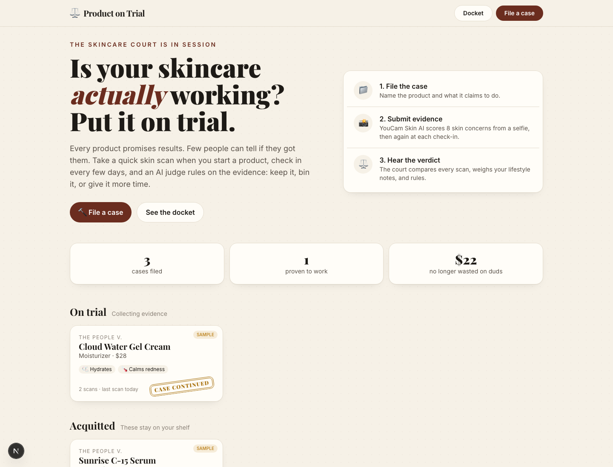
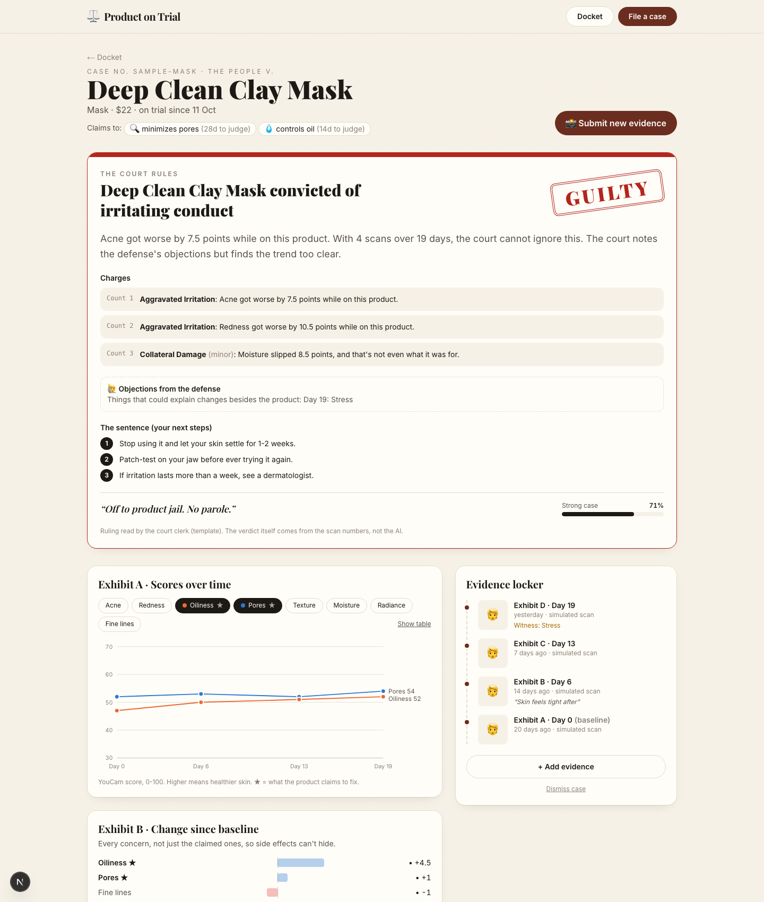
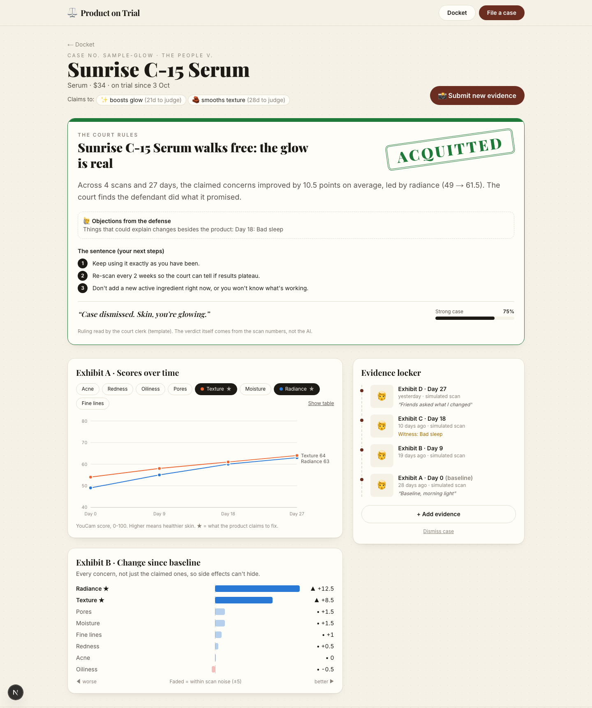
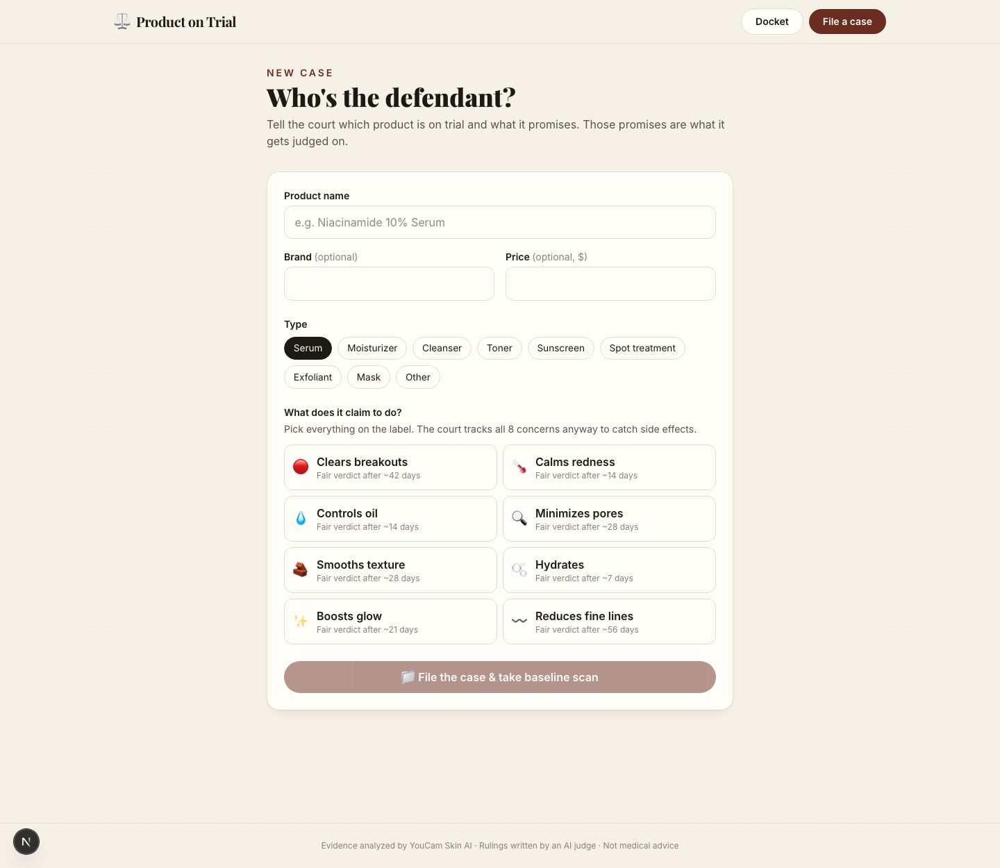

# ⚖️ Product on Trial

**Is your skincare actually working? Put it on trial.**

**Live demo: https://you-cam-api.vercel.app/** · **Demo video: https://youtu.be/p6zLUIZvGU0**

[](https://youtu.be/p6zLUIZvGU0)

People spend a lot on skincare and almost never find out whether a product did anything. Results are slow, mirrors are biased, and a bad night's sleep looks the same as a bad serum. So people keep paying for products that don't work, or drop ones that do because they gave up after a week.

Product on Trial turns that question into a court case:

1. **File the case.** Name the product and pick what it claims to do (clears breakouts, hydrates, boosts glow…).
2. **Submit evidence.** Take a bare-faced selfie. **YouCam Skin AI** scores 8 skin concerns. Check in every few days.
3. **Hear the verdict.** The court compares every scan against the baseline and the product's own claims, weighs your lifestyle notes, and rules:
   - ✅ **Acquitted**: it's working, keep it on the shelf.
   - ⛓️ **Guilty**: it's irritating your skin, or it had enough time and did nothing. Off to product jail.
   - ⏳ **Case continued**: not enough evidence yet. The court sets the next hearing date.

The ruling is delivered in a playful courtroom voice, citing your exact numbers, with concrete next steps tailored to the concern (e.g. barrier-repair advice when moisture drops, a patch-test when redness rises).



## Why it's built this way

- **Judged against its own claims.** A hydrating cream is judged on moisture, not acne. Each claim has a realistic time-to-results (hydration ~7 days, texture ~28, acne ~42), so the court won't convict a retinol after 5 days.
- **Side effects can't hide.** All 8 concerns are scanned every time. If redness or acne gets worse, that's an *Aggravated Irritation* charge, even when the product "worked" on what it claimed.
- **Witness statements.** At each check-in you can log confounders (bad sleep, stress, period, started another product, weather). These show up as *objections* and lower the court's confidence, so the product isn't blamed (or credited) unfairly.
- **Noise-aware.** Lighting and angle make scores wobble a few points, so changes within ±5 are treated as noise. With 3+ scans the latest two are averaged so one bad photo can't decide a case.
- **The numbers decide.** The verdict comes from a deterministic engine (`src/lib/verdict.ts`), so it's consistent and explainable. Rulings are written by a rule-based "court clerk" (`src/lib/clerk.ts`). Optionally, an LLM judge (Claude) can rewrite them in its own words, but it can never change the verdict.
- **Private by default.** Cases and photo thumbnails stay in your browser (localStorage). Photos are sent only to YouCam for the scan; the judge sees scores and notes, never photos.

| Guilty | Acquitted |
|---|---|
|  |  |



## YouCam API usage

**AI Skin Analysis** (`/s2s/v2.1/task/skin-analysis`) is the evidence lab. See `src/lib/youcam.ts`:

1. `POST /s2s/v2.0/file` registers the photo, then the bytes are `PUT` to the signed upload URL.
2. `POST /s2s/v2.1/task/skin-analysis` with `src_file_id` and 8 SD `dst_actions`: `acne, redness, oiliness, pore, texture, moisture, radiance, wrinkle` (`format: "json"`, mask overlays on).
3. `GET /s2s/v2.1/task/skin-analysis/{task_id}` is polled with backoff until `success`.
4. Each concern's `ui_score` (0-100, higher = healthier) is stored as evidence, and the detection `mask_urls` are shown as "forensic photos".

Engine errors (face too small, too dark, out of frame…) are turned into friendly retake instructions. One scan costs 12 units (8 SD concerns).

## Run it

```bash
npm install
cp .env.example .env.local   # add your keys
npm run dev                  # http://localhost:3000
```

| Variable | What it does |
|---|---|
| `YOUCAM_API_KEY` | YouCam API key ([get one](https://yce.makeupar.com/api-console/en/api-keys/)). Without it, scans are **simulated** so you can still try the whole flow. |
| `ANTHROPIC_API_KEY` | Optional. Lets Claude write the ruling text. Without it, the rule-based court clerk writes it (the verdict is identical either way). |
| `DEMO_MODE=1` | Forces simulated scans even with a YouCam key (saves units while developing). |
| `SCANS_PER_IP_PER_DAY` / `SCANS_PER_DAY` | Soft daily caps on real scans for a public deployment (defaults 8 / 40). Over the cap, scans are simulated and the user is told. |

The app opens with three sample cases (one of each verdict) so you can explore right away. You can dismiss them and restore them from the docket.

## Tech

Next.js 16 (App Router) · TypeScript · Tailwind CSS 4 · YouCam AI API · optional Claude for ruling text · no database (localStorage).

```
src/lib/verdict.ts     verdict engine: deltas, trends, charges, objections, confidence
src/lib/youcam.ts      YouCam upload + skin analysis + polling
src/lib/judge.ts       Claude ruling (falls back to src/lib/clerk.ts)
src/app/api/scan       photo -> YouCam scores (or simulated)
src/app/api/verdict    case -> analysis + ruling
src/app/case/[id]      the courtroom: ruling, charts, evidence locker
```

## Disclaimer

Product on Trial is for curiosity and better shopping decisions, not medical advice. For persistent irritation, see a dermatologist.

## License

MIT
